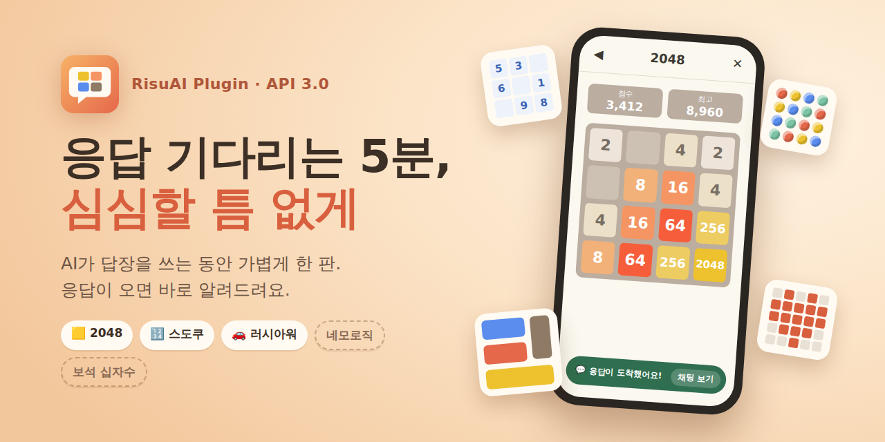

<p align="center"></p>

#  risu-minigame

RisuAI 응답을 기다리는 동안 즐기는 미니게임 플러그인이에요 (API 3.0).
모바일(iOS Safari 포함)에서도 가볍게 돌아가는 걸 목표로 만들고 있어요.

| 게임 | 상태 |
|---|---|
| 🟨 2048 | ✅ 플레이 가능 |
| 🔢 스도쿠 (쉬움 / 보통 / 어려움) | ✅ 플레이 가능 |
| 🚗 러시아워 (120레벨, 3~29수) | ✅ 플레이 가능 |
| 네모로직 · 보석 십자수 | 🚧 예정 |

## 설치
1. [Releases](../../releases)에서 최신 `risu-minigame.js`를 받아요.
2. RisuAI 설정 → 플러그인 → 파일 가져오기
3. 채팅 입력칸 옆 ☰ 메뉴 → **미니게임**으로 열어요.

**업데이트:** RisuAI 설정 → 플러그인 화면을 열면 새 버전이 있을 때 미니게임 옆에 초록 ➕ 버튼이 떠요. 누르면 바로 업데이트돼요.
(v0.2.1부터 지원해요. 그 전 버전을 쓰고 있다면 한 번만 Releases에서 직접 받아 다시 가져와 주세요.)

조작 (`Esc`로 닫기)
- 2048: 방향키, WASD, 마우스 드래그, 터치 스와이프
- 스도쿠: 칸 탭 + 숫자패드, 방향키·WASD 이동, `1`–`9` 입력, `Backspace` 지우기, `N` 메모, `Ctrl+Z` 되돌리기
- 러시아워: 차를 끌어서 옮기기
  - 키보드: 방향키·WASD로 이동하거나, 차의 방향과 다른 쪽을 누르면 그쪽 차를 선택해요.
  - `Tab` 선택, `Z` 되돌리기, `R` 처음부터, `H` 힌트
  - 같은 차를 연달아 움직이면 한 수로 세요. 최소 이동 수로 깨면 별 3개예요.

스도쿠 퍼즐은 매번 새로 만들어요. 해가 하나뿐인지 확인하고, 사람이 쓰는 풀이 기법으로 난이도를 매겨요.
- 쉬움·보통: 싱글(naked/hidden)만으로 풀려요.
- 어려움: locked candidates나 naked pair가 있어야 풀려요.

### 응답 도착 알림 (선택)
처음 열 때 켤지 물어보고, 나중에 메뉴에서 켜고 끌 수 있어요.

켜면 RisuAI가 `replacer` 권한을 한 번 물어봐요.
- 응답이 완전히 끝났다는 신호를 받는 API(`addRisuChatListener`)에 이 권한이 필요해요.
- 권한은 플러그인 코드 해시 기준으로 저장돼서, 새 버전을 설치하면 다시 물어봐요.

## 개발
```bash
npm install
npm test               # 게임 로직 단위 테스트 (node:test)
npm run build          # dist/risu-minigame.js (minify)
npm run build -- --dev # minify 없이
```

**하네스로 확인하기**
1. `python3 -m http.server 8787`을 실행해요.
2. `http://localhost:8787/dev/harness.html`을 열어요.

하네스는 호스트의 sandbox·CSP 구조를 그대로 흉내 내요. `?perm=grant` 또는 `?perm=deny`를 붙이면 가짜 권한 응답을 고정할 수 있어요.

호스트 API에서 확인한 사실과 주의점은 [docs/host-notes.md](docs/host-notes.md)에 있어요.

러시아워 레벨은 `node scripts/gen-rushhour.mjs [샘플 수] [시드] [언덕 오르기 횟수]`로 다시 만들 수 있어요. 결과는 `src/games/rushhour/levels.js`에 저장되고, 기본값으로 3~4분쯤 걸려요.
1. 랜덤 배치에서 갈 수 있는 상태를 전부 탐색해요.
2. 출구에서 가장 먼 상태를 퍼즐로 골라요.
3. 언덕 오르기로 더 어려운 판을 찾아요.

## 릴리스
1. `package.json`의 `version`을 올리고 커밋해요.
2. 같은 버전으로 태그를 push해요:
   ```bash
   git tag v0.2.0 && git push origin v0.2.0
   ```
3. GitHub Actions가 테스트하고 빌드한 뒤, Release에 `risu-minigame.js`를 올려요.
   정식 버전이면 `release` 브랜치도 갱신해요. 플러그인의 `//@update-url`이 가리키는 곳이라, RisuAI에서 업데이트 버튼이 뜨게 돼요.
   - 태그와 `package.json` 버전이 다르면 실패해요.
   - `v0.2.0-beta.1`처럼 `-`가 들어간 태그는 pre-release로 올라가요.

## 구조
- `src/main.js`: 진입점. 버튼 등록, 알림(선택), unload 정리
- `src/core/host.js`: 저장소 래퍼 (접두사 + 디바운스 저장)
- `src/core/input.js`: 방향키·WASD·스와이프를 하나의 방향 입력으로
- `src/shell/`: 전체화면 셸. 닫히면 DOM과 리스너를 모두 정리해요
- `src/games/<id>/`: `logic.js`(순수 로직, 테스트 대상) + `view.js`(`mount(root, ctx)` → `{ dispose }`)
- `assets/`: 아이콘·히어로 이미지 (`hero.html`이 원본이고, 1280×640으로 캡처하면 돼요)
